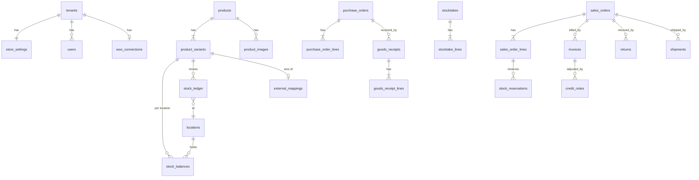

# 03 · Database model

PostgreSQL 16. Extends Phase 1 migrations; new tables arrive one migration per build stage (`0100_catalog.sql`, `0200_inventory.sql`, …). Phase 1 table names below (`tenants`, `users`, `sessions`, `plans`, `store_settings`, `audit_events`) are taken from the Phase 1 README; check them against `apps/api/migrations` before writing B2 migrations, and where they differ Phase 1 wins.

## 1. Conventions (apply to every table below)

| Rule | Detail |
|---|---|
| Keys | `id uuid PRIMARY KEY DEFAULT gen_random_uuid()`. Plus `UNIQUE (tenant_id, id)` so children use composite FKs `(tenant_id, x_id) REFERENCES x (tenant_id, id)`, as Phase 1 does. A row can never point at another tenant's row. |
| Tenancy | `tenant_id uuid NOT NULL REFERENCES tenants(id)`. RLS `ENABLE` + `FORCE`; policy in 04-tenancy-and-permissions.md. |
| Money | `numeric(14,2)` for document totals; `numeric(14,4)` for unit price/cost. Never float. API sends strings. |
| Quantity | `numeric(14,3)` (supports kg/m). Integer-only units enforced by `units.allow_fraction=false` check in service. |
| Time | `timestamptz`, UTC. Render in `tenants.timezone`. |
| Status | `text` + `CHECK (status IN (...))`. No Postgres enums (they need a migration lock to extend). |
| Codes | SKU, barcode, GSTIN, HSN, pincode are `text` (leading zeros). Case-insensitive uniqueness via `lower()` index for SKU. |
| Audit columns | `created_at`, `created_by` (user id), `updated_at` on mutable tables only. Immutable tables have `posted_at`, `posted_by`. |
| Deletes | No hard delete on anything referenced by history. `archived_at timestamptz` instead. FKs are `ON DELETE RESTRICT`. |
| Immutable tables | `erp_rt` gets `SELECT, INSERT` only (no UPDATE/DELETE): `stock_ledger`, `invoices`, `invoice_lines`, `credit_notes`, `credit_note_lines`, `payments`, `audit_events`. |
| Indexes | Every FK, every `(tenant_id, status, created_at DESC)` used by a list screen, and every external id. Listed per table below only when non-obvious. |

## 2. Entity relationship overview

## 3. Tables by module

### 3.1 tenants (Phase 1, extended)

**store_settings** — add columns in B3/B5:
`state_code text` (2-digit GST state code), `gstin text NULL CHECK (gstin ~ '^[0-9]{2}[A-Z0-9]{13}$')`, `prices_include_tax bool DEFAULT true`, `allow_negative_stock bool DEFAULT false` (INV-08), `online_location_id uuid` (D20), `low_stock_default numeric(14,3)`, `discount_reason_threshold_pct numeric(5,2) DEFAULT 10`, `barcode_prefix text DEFAULT '200'` (EAN-13 in-store range 200–299).

**invoice_series** — `(tenant_id, doc_type, financial_year, prefix)` UNIQUE; `doc_type IN ('invoice','credit_note')`; `financial_year text` ('2026-27'); `next_number int`. Indian GST invoice numbers must be unique per financial year and at most 16 characters (CGST Rule 46, to be confirmed by your tax adviser, D7), so `prefix || number` length is checked on insert.

### 3.2 files

**files** — `object_key text UNIQUE` (`{tenant_id}/{kind}/{uuid}.{ext}`), `kind IN ('product_image','import','export','invoice_pdf')`, `content_type`, `byte_size bigint`, `sha256 text`, `status IN ('pending','ready','rejected')`, `expires_at` (imports/exports auto-expire). Upload flow: API issues presigned PUT with exact content-length and type → client uploads → `confirm` re-checks size + magic bytes in the worker → `ready`.

### 3.3 catalog (B2)

| Table | Columns (beyond conventions) | Constraints |
|---|---|---|
| categories | name, parent_id NULL, archived_at | UNIQUE (tenant_id, lower(name), parent_id) |
| brands | name, archived_at | UNIQUE (tenant_id, lower(name)) |
| units | name, abbr, allow_fraction bool | UNIQUE (tenant_id, lower(abbr)) |
| products | name, description, category_id, brand_id, unit_id, type (`simple`,`variable`), status (`draft`,`active`,`archived`), hsn_code, gst_rate numeric(5,2), tracking (`none`,`batch`,`serial`), publish_to_web bool, publish_state (`not_published`,`queued`,`synced`,`failed`,`needs_review`), publish_error text, search tsvector (generated from name) | GIN index on search; allowed GST rates kept as a config list, not a CHECK, because slabs change by notification (the 2025 rationalisation moved most goods to 5/18/40) |
| product_variants | product_id, sku, barcode NULL, attributes jsonb (`{"size":"M","colour":"Red"}`), price numeric(14,4), cost numeric(14,4), mrp numeric(14,4) NULL, weight_g, length/width/height_mm, reorder_level numeric(14,3), status, archived_at | UNIQUE (tenant_id, lower(sku)); UNIQUE (tenant_id, barcode) WHERE barcode IS NOT NULL; UNIQUE (product_id, attributes) |
| product_images | product_id, variant_id NULL, file_id, sort_order, is_primary, alt_text, sync_state (`pending`,`synced`,`failed`), woo_media_id, last_error | one primary per product: UNIQUE (product_id) WHERE is_primary |
| barcode_sequences | tenant_id PK, next_value bigint | locked row; generator = prefix + zero-padded sequence + EAN-13 check digit |
| import_jobs | kind (`products`,`opening_stock`), file_id, mapping jsonb, status (`uploaded`,`validated`,`importing`,`done`,`failed`), total_rows, valid_rows, error_rows, error_file_id | |

`cost` is a column on variants, so cost hiding is done in the API response layer (field removed unless `cost.view`), backed by a column-level grant test. Batch/serial (CAT-09, Should) adds `stock_lots (variant_id, lot_no, expiry_date)` and `serial_numbers (variant_id, serial, status, location_id)` in B3 only if a pilot store needs it; ledger rows already carry nullable `lot_id`/`serial_id` so the ledger shape does not change.

### 3.4 inventory (B3)

| Table | Columns | Notes |
|---|---|---|
| locations | name, type (`shop_floor`,`back_room`,`quarantine`), is_sellable bool, active | Quarantine location is non-sellable by definition |
| stock_balances | PK (tenant_id, variant_id, location_id); on_hand, reserved, non_sellable, version int, updated_at | `CHECK (reserved >= 0 AND non_sellable >= 0)`. `on_hand >= 0` enforced in service unless `allow_negative_stock` or explicit override. ATS = Σ(on_hand − reserved) over sellable locations (INV-02). |
| stock_ledger | variant_id, location_id, bucket (`sellable`,`non_sellable`), qty_delta (signed), balance_after, movement_type, source_type, source_id, source_line_id, reversal_of_id, reason_code, note, lot_id, serial_id, unit_cost numeric(14,4) NULL, posted_at, posted_by | **append-only**. Index (tenant_id, variant_id, posted_at DESC), (tenant_id, source_type, source_id). `movement_type IN ('opening','receipt','sale','dispatch','adjustment','writeoff','transfer_out','transfer_in','return_in','supplier_return','stocktake','reversal')` |
| stock_reservations | order_id, order_line_id, variant_id, location_id, qty, state (`active`,`converted`,`released`,`exception`), idempotency_key, created_at, closed_at | UNIQUE (tenant_id, idempotency_key); partial index (tenant_id, variant_id) WHERE state='active' |
| adjustments | number, location_id, reason_code (`damage`,`expiry`,`loss`,`correction`,`opening`), note, status (`posted`), override_negative bool | header for a group of ledger rows; lines are the ledger rows (`source_type='adjustment'`) |
| transfers | number, from_location_id, to_location_id, note, status (`posted`) | paired ledger rows, one tx |
| stocktakes | number, scope jsonb, status (`counting`,`review`,`posted`,`cancelled`), snapshot_at, submitted_by, approved_by, posted_at | |
| stocktake_lines | stocktake_id, variant_id, location_id, expected_qty, counted_qty NULL, moved_during_count numeric, variance (generated) | UNIQUE (stocktake_id, variant_id, location_id) |

Reconciliation invariant (nightly job + alert, PRD 17.1): for every balance row, `on_hand = Σ ledger.qty_delta WHERE bucket='sellable'`, `non_sellable = Σ … bucket='non_sellable'`, `reserved = Σ active reservations`. Any mismatch raises an alert and is never auto-fixed.

### 3.5 purchasing (B3)

| Table | Columns | Notes |
|---|---|---|
| suppliers | name, phone, email, gstin, state_code, address jsonb, archived_at | UNIQUE (tenant_id, lower(name)) |
| purchase_orders | number, supplier_id, status (`draft`,`submitted`,`partial`,`closed`,`cancelled`), expected_date, notes, totals | UNIQUE (tenant_id, number) |
| purchase_order_lines | po_id, variant_id, ordered_qty, received_qty, unit_cost, gst_rate | `received_qty` updated only by receipt posting |
| goods_receipts | number, po_id NULL, supplier_id, supplier_invoice_no, received_at, status (`posted`) | immutable once posted |
| goods_receipt_lines | receipt_id, po_line_id NULL, variant_id, location_id, received_qty, accepted_qty, damaged_qty, unit_cost | `CHECK (accepted_qty + damaged_qty = received_qty)` |
| supplier_returns (+lines) | supplier_id, receipt_id NULL, reason, status (`posted`); lines: variant_id, location_id, bucket, qty | ledger `supplier_return` |

Receipt line math (AC-05): `received_qty` = what arrived; `accepted_qty` → sellable ledger; `damaged_qty` → non_sellable ledger; short = `ordered − received` and is derived, not stored.

### 3.6 sales (B4 Woo orders, B5 POS)

| Table | Columns | Notes |
|---|---|---|
| customers | name, phone, email, gstin, state_code, billing_address jsonb, shipping_address jsonb, woo_customer_id, archived_at | UNIQUE (tenant_id, woo_customer_id) WHERE NOT NULL. Minimal PII (privacy NFR). |
| sales_orders | number, channel (`pos`,`woocommerce`), external_id, woo_status (raw), woo_modified_at, status, payment_state, customer_id, customer_snapshot jsonb, place_of_supply text, subtotal, discount_total, tax_total, total, currency, idempotency_key, placed_at | UNIQUE (tenant_id, channel, external_id); UNIQUE (tenant_id, idempotency_key) |
| sales_order_lines | order_id, variant_id NULL (unmatched SKU), sku, name, qty, unit_price, discount, discount_reason, taxable_value, gst_rate, hsn_code, woo_line_id | |
| payments | order_id, method (`cash`,`card`,`upi`,`woo`,`other`), amount, status (`recorded`,`confirmed`,`refunded`), reference, recorded_at | immutable; refunds are new rows |
| order_events | order_id, kind, from_status, to_status, payload_ref, at | timeline for order detail screen |
| returns | number, order_id NULL, invoice_id NULL, reason, refund_method, refund_state, status (`posted`) | |
| return_lines | return_id, order_line_id NULL, variant_id, qty, condition (`resellable`,`damaged`,`quarantine`), restock bool | restock only when resellable (5.7) |

Order status values: `awaiting_payment`, `on_hold`, `paid`, `stock_exception`, `ready_to_pick`, `picking`, `packed`, `dispatched`, `completed`, `cancelled`, `failed`, `refunded`, `needs_review`. Payment state: `awaiting`, `paid`, `failed`, `refunded`, `partially_refunded`.

### 3.7 invoicing (B5)

| Table | Columns | Notes |
|---|---|---|
| invoices | number, series_id, source_type (`sales_order`), source_id, state (`posted`,`voided_by_reversal`), seller_snapshot jsonb, buyer_snapshot jsonb, place_of_supply, supply_type (`intra`,`inter`), taxable_total, cgst, sgst, igst, cess, round_off, total, pdf_file_id, issued_at | UNIQUE (tenant_id, number). State change to voided is the **only** update allowed, via a SECURITY DEFINER function that also issues the reversing credit note. |
| invoice_lines | invoice_id, description, hsn_code, qty, unit, unit_price, discount, taxable_value, gst_rate, cgst, sgst, igst | snapshot; never recomputed |
| credit_notes (+lines) | number, invoice_id, return_id NULL, reason, same tax columns | linked, original untouched (AC-14) |

### 3.8 woocommerce + jobs (B4; `sync_jobs` from B2)

| Table | Columns | Notes |
|---|---|---|
| woo_connections | tenant_id UNIQUE (A-01), site_url, key_enc bytea, secret_enc bytea, webhook_secret_enc bytea, endpoint_token_hash text UNIQUE, status (`connected`,`error`,`disconnected`), woo_version, last_success_at, last_error | secrets AES-256-GCM, key from KMS (see 05) |
| external_mappings | variant_id UNIQUE, woo_product_id, woo_variation_id, last_pushed_hash, last_pushed_at, state | UNIQUE (tenant_id, woo_product_id, woo_variation_id) |
| webhook_events | event_key, topic, resource_id, payload jsonb, status (`received`,`processed`,`failed`,`ignored_stale`), attempts, last_error, received_at, processed_at | UNIQUE (tenant_id, event_key). Payload purged after 90 days. |
| sync_jobs | kind (`thumbnail`,`woo.product`,`woo.image`,`woo.stock`,`woo.fulfilment`,`woo.inbound`,`pdf`,`import`,`export`,`reconcile`), resource_id, status (`pending`,`running`,`done`,`failed`,`dead`), priority smallint, attempts, next_attempt_at, locked_by, locked_at, last_error, created_at, done_at | partial UNIQUE (tenant_id, kind, resource_id) WHERE status='pending' (coalesces repeated stock pushes, D21). Index (status, next_attempt_at, priority) WHERE status='pending'. Done rows purged after 30 days. |

**idempotency_keys** (B2, shared) — PK (tenant_id, key); `request_hash`, `status_code`, `response jsonb`, `created_at`. Inserted in the same transaction as the write it protects; purged after 24 h.

Stale-job recovery: a job `running` with `locked_at` older than 5 min goes back to `pending` (worker crash).

### 3.9 fulfilment (B6)

| Table | Columns |
|---|---|
| pick_lists | number, status (`open`,`picking`,`picked`,`cancelled`), assigned_to, created_at |
| pick_list_lines | pick_list_id, order_line_id, variant_id, location_id, qty_required, qty_picked |
| shipments | order_id, carrier, service, tracking_no, shipped_at, woo_update_state (`pending`,`synced`,`failed`) |

## 4. Capacity check

A busy SMB tenant: 5,000 variants, 300 POS lines/day, 100 web orders/day. Ledger grows by ~2k rows/day/tenant (≈0.7 M/year). At 500 tenants that is ~350 M rows/year, which is the first table to partition (by `posted_at` month) — decide at 50 M rows, not before. Everything else stays well under 10 M rows per table in year one.
